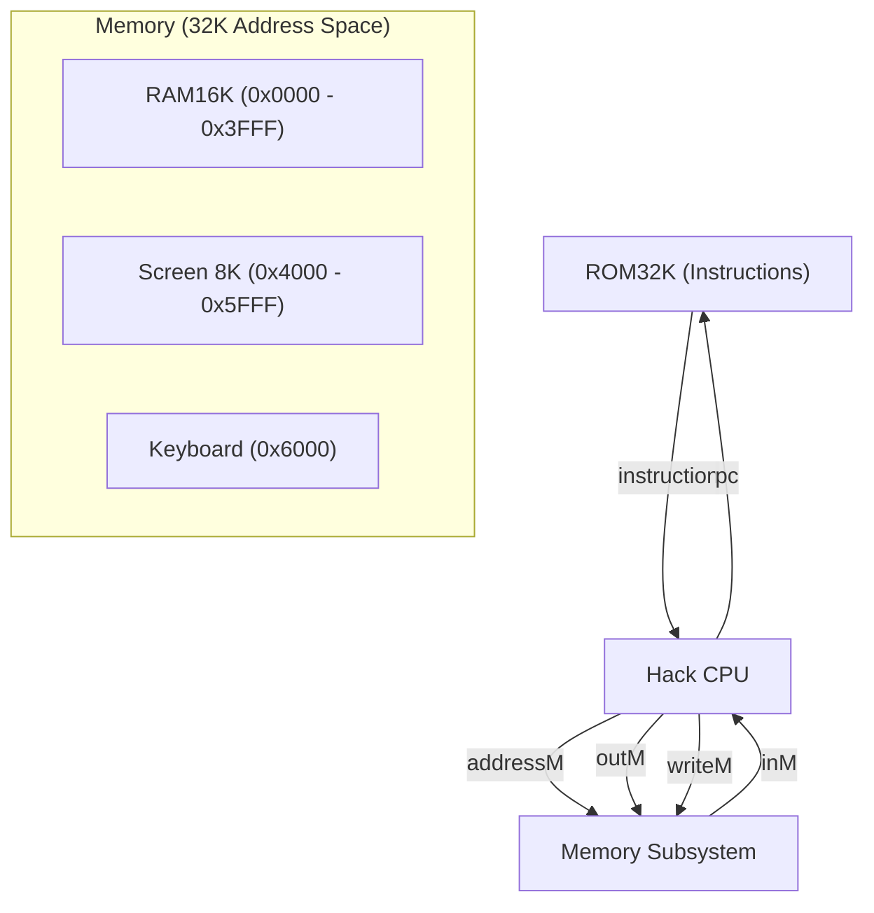

# Hack Computer Architecture Design & Verification

## 1. Architectural Overview
The Hack computer is a 16-bit Von Neumann architecture machine featuring a unified memory map for data, screen, and keyboard, paired with a 32K instruction ROM and a dedicated central processing unit (CPU).

---

## 2. Component Specifications

### CPU (`CPU.hdl`)
- **Instruction Decoding**:
  - `instruction[15] == 0`: A-instruction. Loads 15-bit constant into the A-register.
  - `instruction[15] == 1`: C-instruction format `111 a cccccc ddd jjj`.
- **Registers**:
  - `ARegister`: Loaded when `instruction[15] == 0` or (`instruction[15] == 1` and `instruction[5] == 1`).
  - `DRegister`: Loaded when `instruction[15] == 1` and `instruction[4] == 1`.
- **ALU Operations**: Computes Hack operations controlled by `c1..c6` (`instruction[11..6]`). M-input selected when `instruction[12] == 1` (`a` bit), otherwise A-register.
- **Branching (Program Counter)**:
  - Branch conditions evaluated from `zr` and `ng` flags against jump bits `j1..j3` (`instruction[2..0]`).
  - If condition met and C-instruction active, `load = 1`, `inc = 0`, branching to the address in the A-register.

### Memory (`Memory.hdl`)
- Addresses decoded using the two high-order bits `address[13..14]`:
  - `00` or `01`: `RAM16K` (`0x0000` to `0x3FFF`, addresses `0` to `16383`).
  - `10`: `Screen` (`0x4000` to `0x5FFF`, addresses `16384` to `24575`).
  - `11`: `Keyboard` (`0x6000`, address `24576`).
- Write operations controlled via `DMux4Way` with `load`.
- Read operations routed via `Mux4Way16`.

### Computer (`Computer.hdl`)
- Integrates `ROM32K`, `CPU`, and `Memory` in a closed feedback loop.
- Supports external `reset` to jump back to execution address `0`.

---

## 3. Official Test Results

All five official test scripts from Nand to Tetris were executed and passed with exact comparison matching:

| Test Script | Status | Output Comparison | Evidence File |
|---|---|---|---|
| `CPU.tst` | **PASSED** | Comparison ended successfully | [results/CPU.out](file:///c:/Users/WINNTUSIT/Desktop/N2T_Capstone/NAND to Tetris_Anveshna_2501010130/3. Capstone Project/Project Files/part-a-computer/results/CPU.out) |
| `Memory.tst` | **PASSED** | Comparison ended successfully | [results/Memory.out](file:///c:/Users/WINNTUSIT/Desktop/N2T_Capstone/NAND to Tetris_Anveshna_2501010130/3. Capstone Project/Project Files/part-a-computer/results/Memory.out) |
| `ComputerAdd.tst` | **PASSED** | Comparison ended successfully | [results/ComputerAdd.out](file:///c:/Users/WINNTUSIT/Desktop/N2T_Capstone/NAND to Tetris_Anveshna_2501010130/3. Capstone Project/Project Files/part-a-computer/results/ComputerAdd.out) |
| `ComputerMax.tst` | **PASSED** | Comparison ended successfully | [results/ComputerMax.out](file:///c:/Users/WINNTUSIT/Desktop/N2T_Capstone/NAND to Tetris_Anveshna_2501010130/3. Capstone Project/Project Files/part-a-computer/results/ComputerMax.out) |
| `ComputerRect.tst` | **PASSED** | Comparison ended successfully | [results/ComputerRect.out](file:///c:/Users/WINNTUSIT/Desktop/N2T_Capstone/NAND to Tetris_Anveshna_2501010130/3. Capstone Project/Project Files/part-a-computer/results/ComputerRect.out) |
