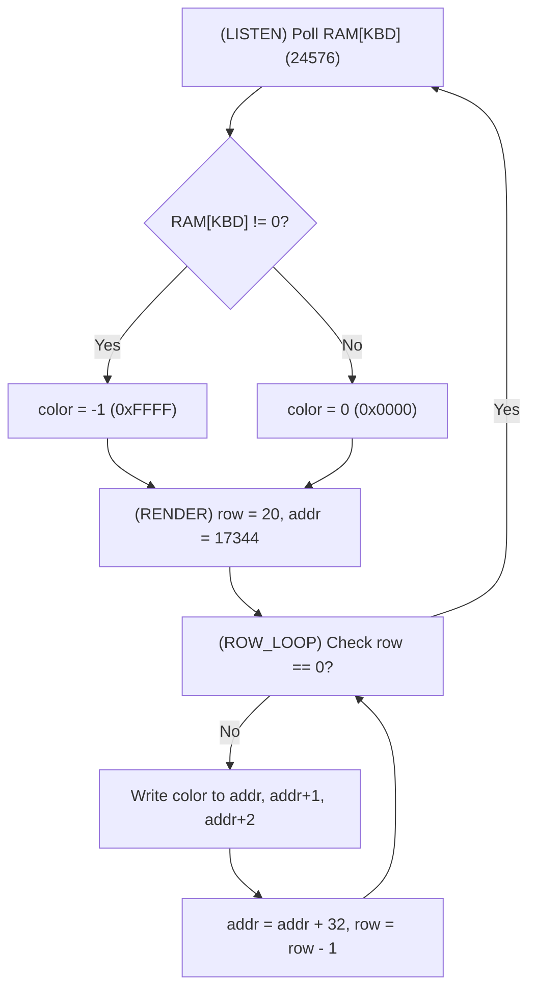

# Keyboard-Controlled Rectangle Program (`Box.asm`)

**Author:** Anveshna  
**University Roll Number:** 2501010130  
**Personal Parameter ($K$):** 30  

---

## 1. Specification & Mathematical Model

The program continuously polls the memory-mapped keyboard address (`KBD` = 24576) and controls a solid rectangle on the Hack display.

| Property | Formula / Requirement | Value for $K=30$ |
|---|---|---|
| Starting Row | $K$ | Row 30 |
| Height | Fixed 20 screen rows | Rows 30 to 49 (inclusive) |
| Width | $16 \times ((K \bmod 4) + 1)$ pixels | $16 \times ((30 \bmod 4) + 1) = 48$ pixels |
| Words per row | Width / 16 | 3 16-bit words |
| Horizontal position | Left edge | Screen words 0, 1, and 2 of each row |
| Display Fill Value | Key pressed ($\neq 0$) | Solid black (`-1` / `0xFFFF`) |
| Display Clear Value| Key released ($= 0$) | Solid white (`0` / `0x0000`) |

### Memory Address Calculation
- Screen base address: `SCREEN = 16384`
- Screen resolution: 512 pixels $\times$ 256 rows (32 words per row)
- Row 30 starting address:
  $$\text{Address} = \text{SCREEN} + (32 \times 30) = 16384 + 960 = 17344$$
- Row 49 ending address:
  $$\text{Address} = \text{SCREEN} + (32 \times 49) = 16384 + 1568 = 17952$$
- Memory words occupied per row:
  - Word 0 (pixels 0–15): $\text{RowBase} + 0$
  - Word 1 (pixels 16–31): $\text{RowBase} + 1$
  - Word 2 (pixels 32–47): $\text{RowBase} + 2$

---

## 2. Program State & Control Flow



---

## 3. Emulation & Test Verification

The program was compiled with our custom `assembler.py` directly into `Box.hack` and evaluated using the official Nand to Tetris `CPUEmulator`:

### Machine-Readable Verification (`BoxTest.tst`):
```text
|RAM[24576]|RAM[17312]|RAM[17344]|RAM[17345]|RAM[17346]|RAM[17347]|RAM[17952]|RAM[17953]|RAM[17954]|RAM[17984]|
|        0 |        0 |        0 |        0 |        0 |        0 |        0 |        0 |        0 |        0 |  <- Idle/Released
|       65 |        0 |       -1 |       -1 |       -1 |        0 |       -1 |       -1 |       -1 |        0 |  <- Key Pressed ('A')
|        0 |        0 |        0 |        0 |        0 |        0 |        0 |        0 |        0 |        0 |  <- Key Released
```

### Observations:
1. **Starting row boundary:** RAM[17312] (Row 29, immediately above) remains `0`, while RAM[17344..17346] (Row 30) transitions to `-1`.
2. **Ending row boundary:** RAM[17952..17954] (Row 49) transitions to `-1`, while RAM[17984] (Row 50, immediately below) remains `0`.
3. **Width boundary:** Column word 3 (RAM[17347]) remains untouched at `0` across all rows.
4. **Interactive dynamic clearing:** When the key register returns to 0, all rectangle words are completely cleared back to `0`.
