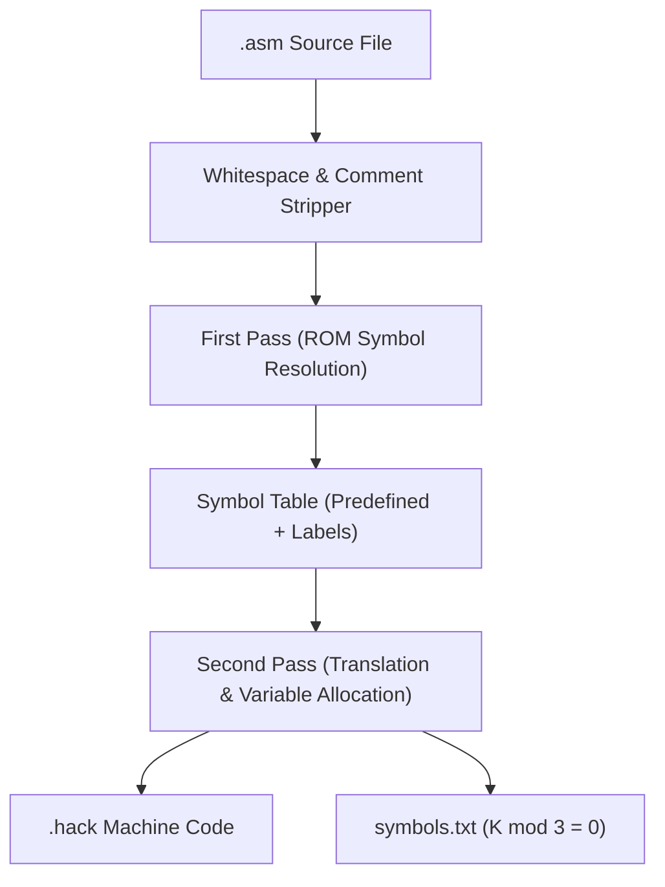

# Hack Two-Pass Assembler Design Specification

**Author:** Anveshna (Roll No. 2501010130)  
**Personal Parameter ($K$):** 30  
**Personalized Feature ($K \bmod 3 = 0$):** Export symbol table containing all labels and variables with their resolved decimal and hexadecimal memory addresses to `symbols.txt`.

---

## 1. Architectural Overview

The Hack Assembler (`assembler.py`) translates source code written in Hack Assembly Language (`.asm`) into binary code (`.hack`) executable on the Hack hardware platform.

---

## 2. Implementation Logic

### Phase 1: Input Processing & Cleaning
- Strips inline comments (`//...`) and trailing/leading whitespace.
- Ignores blank lines.
- Retains original source line numbers to provide accurate diagnostic reporting.

### Phase 2: First Pass — ROM Symbol Resolution
- Identifies label pseudo-commands `(LABEL)`.
- Labels do not increment the ROM instruction counter.
- Binds `LABEL` to the ROM address of the subsequent instruction.

### Phase 3: Second Pass — Binary Code Generation
1. **A-Instructions (`@value` or `@symbol`)**:
   - Begins with MSB `0`.
   - If numeric literal: converted to 15-bit binary string.
   - If symbol: looked up in symbol table. If not present, allocated dynamically to the next available RAM register starting at `RAM[16]`.
2. **C-Instructions (`dest=comp;jump`)**:
   - Begins with prefix `111`.
   - Deconstructs instruction into optional `dest`, mandatory `comp`, and optional `jump` fields.
   - Maps mnemonics to official Hack microcode bit fields (`c1..c6`, `d1..d3`, `j1..j3`).

---

## 3. Benchmark Verification

The assembler was validated against the official Nand to Tetris benchmark suite by assembling each program with both `assembler.py` and the official Nand to Tetris `Assembler.bat`:

| Benchmark Program | Instructions | Output Verification Status | Match Accuracy |
|---|---|---|---|
| `Add.asm` | 6 | **MATCH** | Exact bit-for-bit (100%) |
| `Max.asm` | 16 | **MATCH** | Exact bit-for-bit (100%) |
| `Rect.asm` | 25 | **MATCH** | Exact bit-for-bit (100%) |
| `Pong.asm` | 27,483 | **MATCH** | Exact bit-for-bit (100%) |

All generated machine code files and `symbols.txt` are preserved in `capstone/part-b-assembler/output/`.
